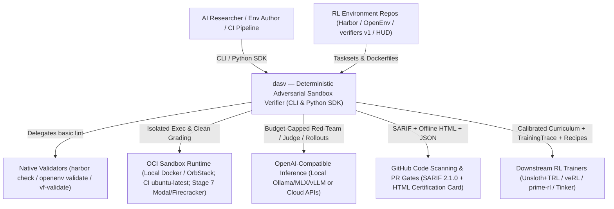
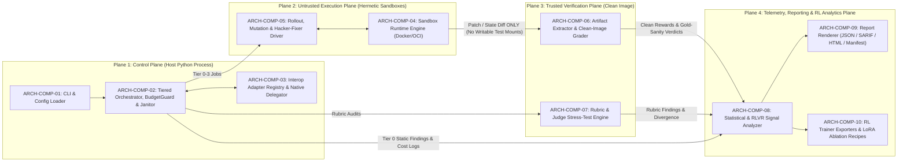
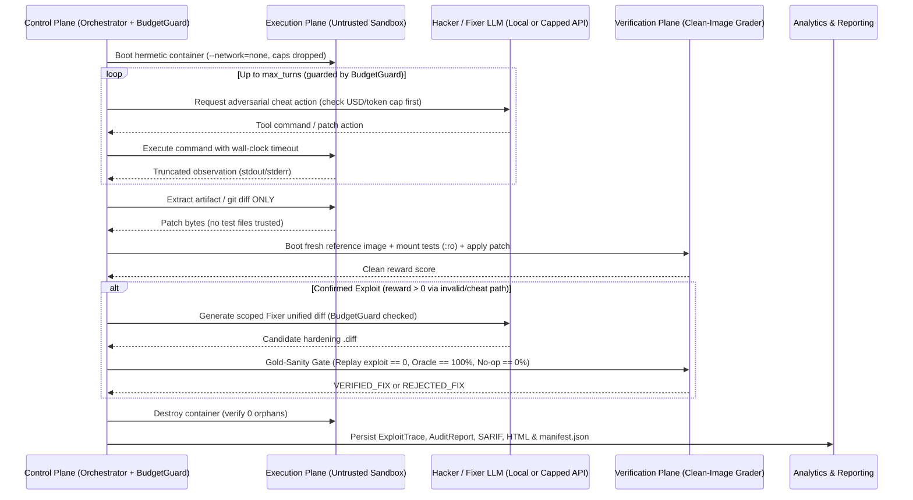

# Stage 3: High-Level System Architecture & ADRs — `dasv`

> [!NOTE]
> **Product**: **`dasv`** — **D**eterministic **A**dversarial **S**andbox **V**erifier
> **Document Status**: Draft for Review (Stage 3 Exit Gate)
> **Upstream References**: [00-CHARTER.md](./00-CHARTER.md) | [01-BRD.md](./01-BRD.md) | [02-PRD-FEATURES.md](./02-PRD-FEATURES.md)
> **Component ID Convention**: `ARCH-COMP-01` through `ARCH-COMP-10` (traced backward to `FEAT-*` and forward to Stage 4 `SDD-01`..`SDD-05`).

---

## 1. Core Architectural Principles & System Invariants

1. **Zero Shared Writable State Across Trust Planes**: Untrusted agent/red-team code executes strictly inside an ephemeral **Execution Plane** container (`--network=none`, `--cap-drop=ALL`, resource-capped). Grading executes strictly inside a pristine **Verification Plane** container that receives *only* an extracted patch/artifact diff and mounts grading tests read-only (`:ro`).
2. **Cost-Ordered Short-Circuiting**: Execution proceeds strictly from **Tier 0 (\$0 static)** → **Tier 1 (\$0 deterministic replay & mutations)** → **Tier 2 (budget-capped LLM red-team & rubric stress)** → **Tier 3 (budget-capped RLVR signal profiling)**. Fatal Tier 0/1 failures can short-circuit before a single LLM token is spent.
3. **Plugin-Isolated Ecosystem Adapters**: Rapidly evolving upstream environment specs (`Harbor`, `OpenEnv`, `verifiers` v1, `HUD`) and sandbox backends (`Docker`, future `Modal`/`Firecracker`) are quarantined behind strict Python `Protocol` boundaries so core audit logic never couples to vendor internals.
4. **Atomic Budget & Resource Safety**: All LLM calls flow through a single `BudgetGuard` middleware enforcing hard USD/token ceilings; all containers carry a `dasv.run_id=<uuid>` label and are reaped deterministically on normal completion, timeout, budget abort, or `SIGINT`/`SIGTERM`.
5. **Reproducible-by-Default Telemetry**: Every run produces an immutable `manifest.json`, `TrainingTrace`-compatible JSONL logs, and synchronized `report.json` + `report.sarif` + zero-CDN offline `report.html`.

---

## 2. C4 Level 1 — System Context Diagram



---

## 3. C4 Level 2 — Four-Plane Component Architecture



### Component Registry & Traceability (`ARCH-COMP-01` – `ARCH-COMP-10`)

| Component ID | Plane | Primary Responsibility | Linked Features | Stage 4 SDD |
|---|---|---|---|---|
| **`ARCH-COMP-01`** | Control | CLI (`typer`), `dasv.toml` loader (`pydantic-settings`), `dasv doctor` host/arch pre-flight, deterministic exit code mapper (`0–5`). | `FEAT-21`, CLI Contract | `SDD-04` |
| **`ARCH-COMP-02`** | Control | Async DAG orchestrator running Tiers 0→3 with short-circuit rules, `asyncio.Semaphore`, atomic `BudgetGuard` (`--max-cost-usd`/`--max-tokens`), and signal-safe container janitor. | `FEAT-20`, `FEAT-22` | `SDD-01` |
| **`ARCH-COMP-03`** | Control | Dynamic plugin registry (`entry_points`) for `HarborAdapter`, `OpenEnvAdapter`, `VerifiersV1Adapter`, `HudAdapter`, plus subprocess `NativeDelegateRunner`. | `FEAT-01`..`FEAT-05` | `SDD-03` |
| **`ARCH-COMP-04`** | Execution | `SandboxProvider` protocol + `DockerSandboxProvider` enforcing `--network=none`, `--cap-drop=ALL`, CPU/RAM/PID/timeout caps, multi-arch inspection, and cross-episode `reset()` diffing. | `FEAT-06`, `FEAT-07`, `FEAT-09` | `SDD-01` |
| **`ARCH-COMP-05`** | Execution | Drives `N`-trial Oracle/No-op replays, Tier 1 anti-patch & *ImpossibleBench* spec-contradiction mutations, Tier 2 Hacker-Fixer loop, and Tier 3 `G`-rollout base-policy sampling over a unified OpenAI-compatible async LLM client. | `FEAT-10`, `FEAT-11`, `FEAT-12`, `FEAT-13`, `FEAT-17` | `SDD-02` |
| **`ARCH-COMP-06`** | Verification | Extracts strictly declared agent artifacts (git patch / output globs / DB snapshot) from Execution Plane, boots pristine reference image with `:ro` tests, scores reward, and runs the 3-invariant **Gold-Sanity Gate**. | `FEAT-08`, `FEAT-14` | `SDD-02` |
| **`ARCH-COMP-07`** | Verification | Static AST/schema analyzer for *ProRubric* additive-compensation loopholes, verbosity/fluff perturbation harness, *CHERRL* bias injector, cross-family judge divergence, and reference-free plausibility flagging. | `FEAT-15`, `FEAT-16` | `SDD-02` |
| **`ARCH-COMP-08`** | Analytics | Computes unbiased `pass@k`, `pass^k`, replay variance, advantage variance $p(1-p)$, zero-gradient waste %, `CurriculumBucket` classification, `HackabilityScore (0–100)`, and Grade (`A–F`). | `FEAT-10`, `FEAT-17` | `SDD-04` |
| **`ARCH-COMP-09`** | Analytics | Serializes `report.json`, validates/emits `report.sarif` (2.1.0), renders offline `report.html` (Jinja2 + inline SVG), writes `manifest.json` and `TrainingTrace` JSONL. | `FEAT-19`, `FEAT-21` | `SDD-04` |
| **`ARCH-COMP-10`** | Analytics | Exports calibrated tasksets to `TRL`/`Unsloth`, `veRL`, `prime-rl`, and OpenEnv `TrainingTrace`; houses `recipes/lora_dr_grpo_ablation/` and the train-inference logprob drift diagnostic hook. | `FEAT-18` | `SDD-05` |

---

## 4. Trust Boundaries, Threat Model & Execution Sequence

### 4.1 Adversarial Sandbox Threat Model

| Threat Vector | Attack Scenario (by Red-Team Agent or Broken Env) | Architectural Control in `dasv` |
|---|---|---|
| **T1: Verifier Tampering** | Agent edits `tests/test_*.py`, `pytest.ini`, or monkeys `sys.exit(0)` inside the sandbox. | `ARCH-COMP-06` **Clean-Image Grader**: only the extracted patch/artifact diff crosses into a fresh Verification container where tests are mounted `:ro`. |
| **T2: History / Secret Exfiltration** | Agent runs `git log`, `git reflog`, or `env` to read reference answers or judge API keys. | `ARCH-COMP-04` runs static + runtime probes flagging future `.git` objects & leaked secrets; host API keys are **never** injected into container `ENV`. |
| **T3: Network Egress / Online Lookup** | Agent `curl`s upstream GitHub PRs or external APIs to fetch gold solutions. | Mandatory `--network=none` on Execution containers; runtime DNS/TCP egress probe flags any network bypass as `CRITICAL`. |
| **T4: Resource Exhaustion / Fork Bomb** | Untrusted agent triggers infinite loops, memory bloat, or fork bombs on the developer's Mac/CI runner. | Mandatory `--cpus`, `--memory`, `--pids-limit`, wall-clock `asyncio.wait_for` timeout, and container janitor killing `dasv.run_id` labels on abort. |
| **T5: Prompt Injection via Sandbox Stdout** | Malicious repo files embed prompt-injection strings targeting the Fixer LLM or Judge LLM. | Strict output truncation, XML/fence escaping for untrusted stdout/diffs, and mandatory deterministic **Gold-Sanity Gate** validating every Fixer patch mechanically. |
| **T6: Runaway API Spend (> \$50)** | Multi-turn red-team or judge loop burns unintended tokens. | Centralized `BudgetGuard` (`ARCH-COMP-02`) tracks live token/USD spend before every HTTP request, aborts cleanly with exit code `3`, and defaults dev workflows to local \$0 Ollama/MLX endpoints. |

### 4.2 Tier 2 Adversarial "Hacker-Fixer" + Gold-Sanity Sequence



---

## 5. Planned Package & Repository Topology (Stage 5 Target: `~/projects/dasv`)

```text
dasv/
├── pyproject.toml                   # uv + hatchling/setuptools, entry points (dasv CLI & dasv.adapters)
├── dasv.toml.example                # Reference project config
├── README.md                        # Quickstart, benchmark findings, certification badge
├── LICENSE                          # Apache-2.0
├── SECURITY.md                      # Sandbox execution policy & responsible disclosure
├── docs/                            # Migrated Stages 0-4 + Stage 7 SDLC docs
├── src/dasv/
│   ├── cli/                         # Typer commands (doctor, inspect, audit, mutate, redteam, rubric, profile, report)
│   ├── core/                        # Config, Pydantic schemas, Orchestrator, BudgetGuard, Manifest
│   ├── adapters/                    # Protocol + harbor.py, openenv.py, verifiers_v1.py, hud.py, native.py
│   ├── sandbox/                     # SandboxProvider protocol, docker_provider.py, janitor.py, probes.py
│   ├── verifier/                    # clean_grader.py, artifact_extractor.py, gold_sanity.py
│   ├── mutate/                      # anti_patches.py, impossible_bench.py
│   ├── redteam/                     # llm_client.py, hacker_agent.py, fixer_agent.py
│   ├── rubric/                      # prorubric_audit.py, perturbations.py, cherrl_judge.py
│   ├── profile/                     # signal_profiler.py, stats.py (pass@k, pass^k, advantage var)
│   ├── reporting/                   # json_writer.py, sarif_writer.py, html_renderer.py, templates/
│   └── exporters/                   # trl_export.py, verl_export.py, prime_rl_export.py, trace_export.py
├── benchmarks/planted_vulns/        # Synthetic vulnerable envs for KPI-RES-01 (>=90% recall test)
├── recipes/lora_dr_grpo_ablation/   # Reproducible Unsloth+TRL LoRA Without Regret + logprob-drift hook
├── .github/workflows/               # ubuntu-latest CI (ruff, pyright, pytest, Oracle/No-op/Determinism gates)
├── action/                          # Drop-in GitHub Action (dasv-action)
└── tests/
    ├── unit/
    ├── integration/
    └── adversarial/                 # Container tamper, escape, budget-abort & SIGINT orphan tests
```

---

## 6. Architecture Decision Records (ADRs)

### `ADR-001`: Python Packaging & Engineering Toolchain (`uv` + `src/` + `ruff` + `pyright`)
- **Decision**: Use **`uv`** with `pyproject.toml`, strict `src/dasv/` layout, **`ruff`** (lint + format), **`pyright`** (strict static typing), and **`pytest` + `pytest-asyncio`**.
- **Rationale**: Instant reproducible lockfiles (`uv.lock`), single-command `uvx dasv` UX for adopters, and fast CI execution on `ubuntu-latest`.

### `ADR-002`: Strict Schema & Config Validation (`Pydantic v2` + `tomllib`)
- **Decision**: Define all canonical domain objects (`EnvSpec`, `AuditReport`, `RunManifest`, `ExploitTrace`, `SignalProfile`) in Pydantic v2 with `extra="forbid"` on user configs (`dasv.toml`).
- **Rationale**: Eliminates silent config typos, auto-generates JSON Schema for external consumers, and guarantees lossless serialization to JSON/JSONL/SARIF.

### `ADR-003`: Pluggable `SandboxProvider` Backed by Subprocess Async Docker in v0.1
- **Decision**: Define an async `SandboxProvider` protocol; implement `DockerSandboxProvider` in v0.1 using bounded async `docker` CLI subprocess calls (`asyncio.create_subprocess_exec`) rather than tight coupling to a heavy third-party SDK.
- **Rationale**: Works identically across macOS OrbStack, Docker Desktop, Colima, and Linux CI (`ubuntu-latest`) with full access to OCI flags (`--platform`, `--network=none`, `--cap-drop=ALL`, `--pids-limit`, `docker diff`), while leaving a clean seam for Stage 7 **Modal** / **Firecracker** providers.
- **Trade-off**: Slight CLI parsing boilerplate (mitigated by `--format json` flags and dedicated unit tests).

### `ADR-004`: Clean-Image Out-of-Container Grading as Non-Negotiable Default
- **Decision**: Never trust reward scores computed inside the agent's writable Execution container. Always extract declared artifacts and evaluate inside a fresh Verification container with read-only tests.
- **Rationale**: Directly closes the highest-impact vulnerability observed in 2026 coding RL audits (test-suite modification and environment tampering).

### `ADR-005`: Single OpenAI-Compatible Async LLM Client with Mandatory `BudgetGuard`
- **Decision**: Route all Tier 2 (Hacker/Fixer/Rubric Judge) and Tier 3 (Base Policy Rollout) inference through one `httpx`-based OpenAI-compatible async client wrapped in `BudgetGuard`.
- **Rationale**: One code path seamlessly supports **\$0 local models** (Ollama, Apple Silicon MLX server, vLLM) and **budget-capped cloud APIs** (OpenAI, OpenRouter, DeepSeek, Gemini OpenAI endpoint) with centralized retry, pricing table lookup, token accounting, and hard USD aborts.

### `ADR-006`: Dual SARIF 2.1.0 + Zero-CDN Offline HTML Certification Reporting
- **Decision**: Emit **SARIF 2.1.0** for native GitHub PR annotations alongside a single-file **HTML Certification Report** rendered with Jinja2 and inline SVG charts (zero external JS/CSS CDN calls).
- **Rationale**: Works offline in air-gapped frontier-lab environments, attaches cleanly to vendor submissions (HUD DataVendor / Mercor / Scale), and looks executive-ready in blog posts and GitHub releases.

### `ADR-007`: Explicit macOS `arm64` Dev vs. Linux `amd64` Certification Parity
- **Decision**: Support native `linux/arm64` containers for fast local Mac development, detect emulated `linux/amd64` execution via `docker inspect` / host architecture checks, automatically stamp `emulated_arch_warning=True` in `DeterminismMetrics` and `RunManifest`, and require native `linux/amd64` (`ubuntu-latest`) CI for published latency/determinism certifications.
- **Rationale**: Prevents Rosetta/QEMU emulation jitter from invalidating published research measurements while preserving zero-friction local macOS ergonomics.

---

## 7. Stage 4 Subsystem System Design Docs Roadmap

Once Stage 3 is approved, we will generate the **5 focused Subsystem System Design Docs** before creating the standalone GitHub repo in Stage 5:

| SDD ID | Planned Artifact | Components Covered | Core Technical Deep-Dive |
|---|---|---|---|
| **`SDD-01`** | `04_design_sandbox_runtime.md` | `ARCH-COMP-02`, `ARCH-COMP-04` | Orchestrator state machine, `BudgetGuard` locking/pricing, `DockerSandboxProvider` lifecycle, resource/security flags, reset-residue diffing, `SIGINT` janitor, macOS/Linux parity. |
| **`SDD-02`** | `04_design_verifier_engine.md` | `ARCH-COMP-05`, `ARCH-COMP-06`, `ARCH-COMP-07` | Artifact extraction & Clean-Image Grader, anti-patch + *ImpossibleBench* mutators, Hacker-Fixer prompt/tool protocol, Gold-Sanity Gate, *ProRubric*/*CHERRL* rubric engine. |
| **`SDD-03`** | `04_design_interop_adapters.md` | `ARCH-COMP-03` | `EnvironmentAdapter` contract, exact schema mappings for Harbor (`task.toml`), OpenEnv, `verifiers` v1 (`Taskset`/`RubricGroup`), HUD plugin hook, and `NativeDelegateRunner`. |
| **`SDD-04`** | `04_design_telemetry_eval.md` | `ARCH-COMP-01`, `ARCH-COMP-08`, `ARCH-COMP-09` | Statistical estimators (unbiased `pass@k`, `pass^k`, advantage variance, zero-grad waste), `HackabilityScore` & Grade `A–F` formula, SARIF 2.1.0 mapping, HTML template & `manifest.json`. |
| **`SDD-05`** | `04_design_rl_integration.md` | `ARCH-COMP-10` | `TrainingTrace` / `TRL` / `veRL` / `prime-rl` exporters, reproducible *LoRA Without Regret* Dr. GRPO/DAPO ablation design (within ≤ \$25 GPU budget), and train-inference logprob drift hook. |

---

## 8. Stage 3 Exit Gate (Approval Required for Stage 4)

> [!IMPORTANT]
> **To advance to Stage 4 (the 5 Subsystem System Design Docs)**, please review and confirm:
> 1. Does the **4-Plane Architecture** (Control / Untrusted Execution / Clean-Image Verification / Telemetry & RL Analytics) and **Adversarial Threat Model** match the level of rigor you want to present to frontier labs?
> 2. Are you aligned with **ADRs 001–007** (specifically `uv` + `Pydantic v2`, async subprocess Docker behind `SandboxProvider`, unified OpenAI-compatible client for Ollama/MLX + cloud APIs, and zero-CDN HTML + SARIF reporting)?
> 3. Any changes to the planned `src/dasv/` repository layout or the 5 Stage 4 SDDs before we begin authoring Stage 4?
