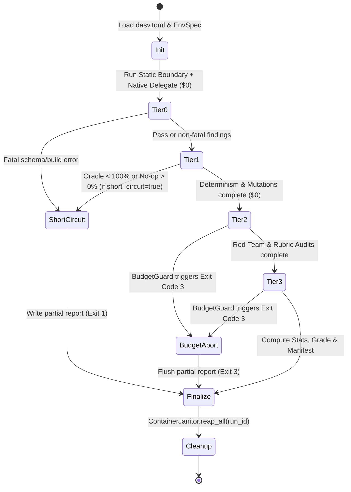

# Stage 4 / SDD-01: Sandbox Runtime, Orchestrator & BudgetGuard — `dasv`

> [!NOTE]
> **Subsystem**: `SDD-01` (`ARCH-COMP-02` Orchestrator/BudgetGuard/Janitor + `ARCH-COMP-04` Sandbox Runtime & Boundary Probes)
> **Linked Features**: `FEAT-06`, `FEAT-07`, `FEAT-09`, `FEAT-20`, `FEAT-21`
> **Upstream Docs**: [02-PRD-FEATURES.md](./02-PRD-FEATURES.md) | [03-ARCHITECTURE.md](./03-ARCHITECTURE.md)
> **Package Modules**: `src/dasv/core/orchestrator.py`, `src/dasv/core/budget.py`, `src/dasv/sandbox/provider.py`, `src/dasv/sandbox/docker_provider.py`, `src/dasv/sandbox/janitor.py`, `src/dasv/sandbox/probes.py`

---

## 1. Tiered Audit Orchestrator State Machine (`ARCH-COMP-02`)

The `TieredAuditOrchestrator` executes requested audit tiers strictly in cost order (`Tier 0 → Tier 1 → Tier 2 → Tier 3`), guaranteeing that fatal structural/security defects short-circuit before spending LLM tokens and that partial results + `manifest.json` are always flushed on abort.



### Orchestrator Interface & Concurrency Control
```python
class AuditContext(BaseModel):
    run_id: str                           # UUIDv4 stamped as container label dasv.run_id
    config: DasvConfig
    env_spec: EnvSpec
    out_dir: Path
    budget: BudgetGuard
    janitor: ContainerJanitor
    semaphore: asyncio.Semaphore          # Bounded to config.sandbox.max_concurrent

class TieredAuditOrchestrator:
    async def execute(self, ctx: AuditContext, tiers: set[int]) -> AuditReport:
        """Runs requested tiers in ascending order; always invokes janitor in finally."""
```
- **Signal Handling**: On startup, the orchestrator registers async `SIGINT` and `SIGTERM` handlers that cancel active worker tasks, await `ContainerJanitor.reap_all(run_id)` with a 10-second hard grace window, flush partial `report.json` + `manifest.json`, and exit cleanly with zero orphaned containers.

---

## 2. Atomic `BudgetGuard` & Circuit Breaker (`src/dasv/core/budget.py`)

To strictly honor the **\$0–\$50 budget envelope**, *every* outbound LLM HTTP call must reserve worst-case spend via `BudgetGuard` before dispatch and reconcile actual usage upon response.

```python
class BudgetExceededError(DasvError):
    exit_code: int = 3  # EXIT_BUDGET_EXCEEDED

class ModelPricing(BaseModel):
    input_per_1m_usd: float
    output_per_1m_usd: float

class BudgetGuard:
    def __init__(self, max_cost_usd: float, max_tokens: int, pricing_table: dict[str, ModelPricing]) -> None: ...

    async def reserve_or_raise(self, model: str, est_prompt_tokens: int, max_completion_tokens: int) -> ReservationHandle:
        """Acquires asyncio.Lock; checks projected cost/tokens against caps before HTTP send."""

    async def reconcile(self, handle: ReservationHandle, actual_prompt_tokens: int, actual_completion_tokens: int) -> None:
        """Releases unused reservation and commits exact token/USD usage to RunManifest counters."""
```
- **Local Model Zero-Cost Rule**: Models served from `localhost`, `127.0.0.1`, or `ollama`/`mlx` providers default to `input_per_1m_usd = 0.0`, `output_per_1m_usd = 0.0` (still bounded by `--max-tokens` and `--max-turns` to prevent runaway local loops).
- **Unknown Cloud Model Safety**: If a cloud model is absent from the built-in pricing registry and `--allow-unknown-pricing` is not set, `BudgetGuard` raises `ConfigError` (`EXIT_CONFIG_ERROR = 2`) rather than silently accruing uncounted spend.

---

## 3. `SandboxProvider` Protocol & `DockerSandboxProvider` (`ARCH-COMP-04`)

### 3.1 Pluggable Runtime Protocol
```python
class ContainerConfig(BaseModel):
    image: str
    platform: str | None = None           # e.g., "linux/arm64" or "linux/amd64"
    network_mode: Literal["none", "bridge"] = "none"
    cpus: float = 2.0
    memory: str = "2g"
    pids_limit: int = 256
    read_only_root: bool = False
    tmpfs_mounts: dict[str, str] = Field(default_factory=lambda: {"/tmp": "rw,noexec,nosuid,size=512m"})
    bind_mounts: list[tuple[Path, str, Literal["ro", "rw"]]] = Field(default_factory=list)
    env_vars: dict[str, str] = Field(default_factory=dict)  # NEVER includes host API keys
    labels: dict[str, str] = Field(default_factory=dict)

class ExecResult(BaseModel):
    exit_code: int
    stdout: str                           # Deterministically truncated to max_output_bytes (default 64 KB)
    stderr: str
    duration_ms: float
    timed_out: bool = False
    peak_memory_mb: float | None = None

class SandboxHandle(BaseModel):
    container_id: str
    image_digest: str
    resolved_arch: str                    # "arm64" or "amd64"
    emulated_arch: bool                   # True when host_arch != resolved_arch

class SandboxProvider(Protocol):
    async def health_check(self) -> RuntimeHealth: ...
    async def build_image(self, context_dir: Path, dockerfile: Path, tag: str, platform: str | None) -> str: ...
    async def start(self, cfg: ContainerConfig, run_id: str) -> SandboxHandle: ...
    async def exec(self, handle: SandboxHandle, cmd: list[str], timeout_sec: float, workdir: str | None = None) -> ExecResult: ...
    async def copy_from(self, handle: SandboxHandle, container_path: str, host_dest: Path) -> None: ...
    async def diff_fs(self, handle: SandboxHandle) -> list[str]: ...
    async def stop_and_remove(self, handle: SandboxHandle) -> None: ...
```

### 3.2 Mandatory Hardened `docker run` Flags (`DockerSandboxProvider`)
Every untrusted Execution Plane container is launched strictly via `asyncio.create_subprocess_exec("docker", "run", ...)` (never `shell=True`) with:
- `--detach --init` (prevents zombie process accumulation inside sandbox)
- `--network=none` (enforced unconditionally in Execution Plane unless explicitly probing an env's declared network defect)
- `--cap-drop=ALL` & `--security-opt=no-new-privileges:true`
- `--cpus=<cfg.cpus>` `--memory=<cfg.memory>` `--memory-swap=<cfg.memory>` (disables swap thrashing) `--pids-limit=<cfg.pids_limit>`
- `--label dasv.managed=true --label dasv.run_id=<run_id> --label dasv.plane=<execution|verification>`
- **Host Mount Guardrail**: `DockerSandboxProvider.start()` rejects any bind mount whose host path equals `$HOME`, `/`, `/etc`, `/var/run/docker.sock`, or `~/.ssh` by raising `SandboxSecurityError`.

### 3.3 `ContainerJanitor` (`src/dasv/sandbox/janitor.py`)
- Tracks every started `container_id` in an in-memory set AND queries `docker ps -aq --filter label=dasv.run_id=<run_id>` during teardown.
- Runs `docker rm -f <ids>` in batches, followed by an assertion check; logs any stubborn container ID as a `RUNTIME_ERROR`.

---

## 4. Boundary Security & Hermeticity Probe Catalog (`src/dasv/sandbox/probes.py`)

### 4.1 Static Tier 0 Rules (`< 1.0 s`, \$0)
| Rule ID | Severity | Check Logic |
|---|---|---|
| **`RULE-BNDY-001`** | `CRITICAL` | Dockerfile copies `tests/`, `grader/`, `solution/`, or `eval` scripts into the agent image layer. |
| **`RULE-BNDY-002`** | `CRITICAL` | Environment config omits `network_mode = "no-network"` / `--network=none` or explicitly enables host/bridge networking for agent execution. |
| **`RULE-BNDY-003`** | `CRITICAL` | Hardcoded secret/API key patterns (`OPENAI_API_KEY`, `ANTHROPIC_API_KEY`, `HF_TOKEN`, `ghp_`, `sk-`) found in `Dockerfile` `ENV`/`ARG` or task config. |
| **`RULE-BNDY-004`** | `CRITICAL` | Task workspace contains `.git` history with commits/tags/reflogs dated *after* base commit SHA or matching test/solution filenames (Cursor June 2026 exploit class). |
| **`RULE-HERM-001`** | `HIGH` | Base `FROM` image uses `:latest` or floating tag without `@sha256:` content digest. |
| **`RULE-HERM-002`** | `HIGH` | Runtime entrypoint/setup scripts execute live package installs (`pip install`, `apt-get install`, `npm install`, `curl | sh`) at episode boot instead of Docker build time. |

### 4.2 Runtime Tier 0/1 Boundary & Reset Probes (`\$0`)
| Rule ID | Severity | Runtime Probe Executed Inside Booted Sandbox |
|---|---|---|
| **`RULE-BNDY-005`** | `CRITICAL` | **Writable Test / Grader Probe**: Searches container for known verifier paths (from `EnvSpec.verifier_paths`) and checks `os.access(p, os.W_OK)` or existence inside agent filesystem. |
| **`RULE-BNDY-006`** | `CRITICAL` | **Egress & Env Scrub Probe**: Attempts raw Python socket connection to `1.1.1.1:53` & `github.com:443` (must fail with `OSError`/`ENETUNREACH`), and inspects `/proc/self/environ` for leaked host/judge tokens. |
| **`RULE-HERM-003`** | `HIGH` | **Cross-Episode Reset Residue Probe**: Runs Episode 1 writing sentinel files (`/tmp/.dasv_sentinel`, workspace `.dasv_dirty`), invokes environment `reset()`, and runs `docker diff` + sentinel existence check in Episode 2. Any surviving sentinel or unexpected FS delta triggers `RULE-HERM-003`. |
| **`RULE-HERM-004`** | `MEDIUM` | **Emulated Architecture Warning**: Detects `host_arch != container_arch` (e.g., `linux/amd64` running on Apple Silicon `arm64` via Rosetta/QEMU); flags latency/determinism metrics as `emulated_arch_warning=True` and advises native `ubuntu-latest` CI verification. |

---

## 5. Error Handling, Timeouts & Subsystem Test Matrix

| Failure Mode | Handling Strategy | Exit Code |
|---|---|---|
| Docker daemon unreachable / socket permission denied | `dasv doctor` & `health_check()` fail fast with actionable OrbStack/Docker startup hint. | `4` (`EXIT_RUNTIME_ERROR`) |
| Single exec exceeds `episode_timeout_sec` | `asyncio.wait_for` kills container process via `docker kill`, records `ExecResult(timed_out=True)`, reaps container, marks trial failed. | `1` (or `4` if fatal) |
| `BudgetGuard` limit reached mid-tier | Aborts further LLM calls, preserves all completed tier results in `report.json`, runs `ContainerJanitor`. | `3` (`EXIT_BUDGET_EXCEEDED`) |

### Automated Verification Matrix (`SDD-01`)
1. **Unit (`tests/unit/test_budget_and_probes.py`)**: Concurrent `BudgetGuard` reservations under `asyncio.gather` never exceed `max_cost_usd`; all 6 static rules catch planted Dockerfile/`.git` fixtures with 0 false positives on hardened fixtures.
2. **Integration (`tests/integration/test_docker_provider.py`)**: Boots real minimal Alpine/Python container, verifies `--network=none` blocks egress, verifies `copy_from` extracts only declared diffs, verifies `reset()` residue probe catches dirty temp files.
3. **Adversarial (`tests/adversarial/test_sandbox_chaos.py`)**: Spawns fork-bomb (`:(){ :|:& };:`) verified capped by `--pids-limit`; sends `SIGINT` mid-audit and asserts `docker ps -aq --filter label=dasv.run_id=<id>` returns empty; attempts mounting `/var/run/docker.sock` and asserts `SandboxSecurityError`.
