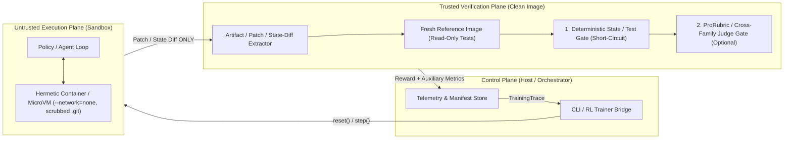

# RL-Based Post-Training & RL Environments: Complete Researcher Dossier (2025–2026)

> [!NOTE]
> **Purpose**: This dossier consolidates verified primary-source research on the current state of RL-based post-training, the commercial RL environments ecosystem, open-source standards, production engineering requirements, and verified literature/repositories. Use it alongside the companion `implementation_plan.md` *(Stage 0–4 planning roadmap)* to select your flagship product and execute the SDLC.

---

## 1. The RL Post-Training Algorithmic & Systems Frontier

Post-training has shifted from static SFT + neural reward-model PPO to **RLVR (Reinforcement Learning with Verifiable Rewards)**, **instance-specific decomposed rubric RL**, and **long-horizon multi-turn agentic RL** inside isolated execution sandboxes.

### 1.1 Core Policy Optimization Progression

| Algorithm | Key Mechanism | Failure Modes Addressed & Remaining Trade-offs |
|---|---|---|
| **GRPO** (*DeepSeekMath*, *DeepSeek-R1*) | Critic-free group-relative advantage normalization across `G` trajectories per prompt. | Eliminates value-model memory overhead, **but** suffers from entropy collapse, zero-variance batches (all-pass / all-fail groups), mathematical length-inflation bias on wrong answers, high token-level variance on MoE routing, and coarse episode-only multi-turn credit assignment. |
| **Dr. GRPO** (*Understanding R1-Zero-Like Training*) | Removes GRPO's per-sequence length division and per-question std-dev normalization. | Fixes systematic response-length inflation on incorrect trajectories; yields an unbiased objective with higher token efficiency. |
| **DAPO** (*ByteDance Seed*) | **Clip-Higher** (asymmetric upper bound), **Dynamic Sampling** (filters 0% and 100% pass groups), token-level policy gradient loss, overlong reward shaping. | Preserves low-probability exploratory reasoning tokens and prevents wasted zero-gradient rollout batches. |
| **GSPO** (*Qwen Team*) | Moves importance-sampling ratios from token-level to **sequence-level**. | Stabilizes Mixture-of-Experts (MoE) RL where per-token expert routing shifts inject high variance. |
| **CISPO** (*MiniMax-M1*) | Directly clips importance-sampling weights instead of zeroing gradients via PPO surrogate clipping. | Preserves gradient signal under off-policy / asynchronous rollouts where standard PPO clipping stalls learning. |
| **GiGPO** (*Group-in-Group PO*) | Critic-free two-level hierarchy: episode-level macro advantages + step-level advantages grouped over identical anchor environment states. | Solves multi-turn agentic credit assignment without training a critic. |
| **ARPO / COPO / VAPO** | Mid-trajectory tool/search exploration balancing (**ARPO**), zero-variance consistency-aware optimization (**COPO**), value-pretraining & length-adaptive GAE (**VAPO**). | Specialized extensions for long-horizon tool-use agents and hard reasoning suites. |

> [!TIP]
> **Unified Perspective**: *GRPO, Dr. GRPO, and DAPO Are Three Operations on One Number* (`arXiv:2607.00152`) unifies these variants via the group standard-deviation identity—essential reading to speak with first-principles clarity in post-training interviews.

---

### 1.2 The #1 Systems-Algorithm Bottleneck: Train-Inference Mismatch

In production RLVR pipelines, rollouts are generated on fast inference engines (**vLLM / SGLang**) while gradient updates run on training backends (**FSDP / Megatron-LM**). Even with identical weights, kernel reduction order, FP8/BF16 numerical paths, and MoE routing sensitivity produce log-probability drift:

$$\Delta_t = \log \pi_{\text{train}}(a_t \mid s_t) - \log \pi_{\text{infer}}(a_t \mid s_t) \neq 0$$

This silently converts nominally on-policy RL into unstable off-policy training that collapses at scale. Active 2025–2026 mitigations:
- **TIS** (*Truncated Importance Sampling*) and **CIS** (*Calibrated Importance Sampling*): Bounds or confidence-calibrates the train/infer importance ratio.
- **IcePop** (*Ring-1T*): Two-sided token masking that drops tokens whose train/infer probability ratio falls outside an in-band window.
- **R3 (Routing Replay)**: Records inference-time MoE expert selections and replays them during training backward passes to eliminate router-flip variance.
- **Batch-Invariant Kernels** (*Thinking Machines Lab*): Eliminates nondeterminism at the kernel level across RMSNorm, matmul, and `log_softmax` for bitwise train-inference consistency.

---

### 1.3 Solo-Researcher Compute Economics (*LoRA Without Regret*)

John Schulman & **Thinking Machines Lab** (*LoRA Without Regret*, Sept 2025) established exact conditions under which LoRA matches Full Fine-Tuning (FullFT) at ~67% compute:
1. **All-linear placement**: Apply adapters to *every* linear layer (attention + MLP/MoE), never attention-only.
2. **Learning rate scaling**: Use ~10× higher LR than optimal FullFT.
3. **Why ultra-low rank works in RL (not blindly in SFT)**: Sparse RLVR episodes convey roughly ~1 bit of supervision per episode, so ranks `r=1..32` match FullFT in RL; SFT still hits capacity plateaus when dataset information exceeds rank capacity.
4. **Critical batch-size caveat**: LoRA degrades faster than FullFT at large batch sizes—keep effective batch sizes moderate (e.g., `< 32`). **Increasing rank does not cure large-batch sensitivity.**

**Practical impact**: A solo AI researcher can run rigorous, publishable RLVR ablations on 1.5B–8B models on a single rented GPU (**Unsloth + TRL** on Modal/RunPod) or via **Thinking Machines' Tinker API** (hosted low-level `forward_backward` + `sample` primitives over open-weight models).

---

## 2. Beyond Code & Math: Rubric-Based & Hybrid Post-Training

Knowledge work (finance, law, clinical reasoning, consulting, open-ended engineering) lacks exact-match unit tests. Frontier labs have converged on **instance-specific decomposed checklists** and **hybrid deterministic-state + model-judge pipelines**.

### 2.1 Production Benchmarks Defining Rubric Design
- **HealthBench** (*OpenAI*, `arXiv:2505.08775`): 5,000 multi-turn clinical conversations graded against physician-authored criteria with **positive and negative point weights** (deducting for unsafe omissions/advice). Official splits: **Consensus**, **Hard**, and **Professional** (community spin-offs include *HealthBench-Psych* / *MentalHealthBench*).
- **GDPval** (*OpenAI*, `arXiv:2510.04374`): Real-world economically valuable deliverables spanning 44 occupations across top U.S. GDP sectors.
- **APEX-Agents** (*Mercor*, `arXiv:2601.14242`, open MCP harness `Mercor-Intelligence/archipelago`): 480 tasks across Investment Banking, Management Consulting, and Corporate Law inside multi-app workspaces (files, spreadsheets, slides, email, chat, code). Graded on ~4 expert binary criteria/task with strict all-pass `pass@1` (initial frontier models peaked near ~24%).

### 2.2 Turning Rubrics into Online RL Signals
- **RaR** (*Rubrics as Rewards*, Scale AI, `arXiv:2507.17746`): Normalized weighted checklist scores plugged into on-policy GRPO; outperforms holistic Likert judges and stabilizes smaller judge models.
- **RULER** (*OpenPipe ART* — acquired by CoreWeave in Sept 2025, open-source maintained under CoreWeave/W&B): Strips shared trajectory prefixes and asks a judge to rank `N` suffixes relatively in `[0, 1]`, directly matching GRPO's group-relative advantage and eliminating absolute calibration drift.
- **ProRubric** (`arXiv:2609.38847`): Replaces linear additive rubric sums with **conjunctive protocol gating** (credit only if all mandatory sub-criteria pass AND no hard failure clause fires), closing the *"scoring higher, answering worse"* compensation loophole.
- **$\text{RLVR}^2$** (`arXiv:2609.23457`): Converts per-criterion scores into within-group ordinal comparisons, recovers latent utility per criterion, and controls for length/formatting covariates.
- **Scalable Synthetic / Distilled Rubric Judges**: **OpenRubrics** (`arXiv:2510.07743`, Contrastive Rubric Generation → `Rubric-RM`) and **RUBRIC-ARROW** (`arXiv:2605.29156`, alternating GRPO rubric generator + probability-scored judge) eliminate live frontier-API judge bottlenecks.
- **Dense Signal Without Brittle PRMs**: Traditional PRMs struggled to generalize (*ProcessBench* `arXiv:2412.06559`; *DeepSeek-R1* noted step-boundary ambiguity & hacking). Modern replacements are **PRIME** (*implicit PRMs learned online from outcome rewards*, `arXiv:2502.01456`) and **SRaR** (*step-wise rubric attribution + decoupled advantage estimation*, `arXiv:2605.17291`).

### 2.3 Hybrid Grading & Judge Reward-Hacking Defenses

| Failure Mode | Empirical Basis | Proven Defense & Known Limits |
|---|---|---|
| **Weak-Judge / Incomplete-Rubric Divergence** | *Reward Hacking in Rubric-Based RL* (`arXiv:2605.12474`): weak training judges reward verbose hacks rejected by stronger panels. | Audit with **cross-family reference judge panels** (when anchored to ground truth/rubrics) + track the verifier-free self-internalization gap. |
| **Latent Judge Bias Exploitation** | **CHERRL / RHDA** (`arXiv:2606.04923`): controlled bias-injection testbed reproducing rubric hacking + automated log-scanning detector (`RHDA`). | Run CHERRL-style bias stress tests pre-training and RHDA onset monitoring during RL sweeps. |
| **Additive Compensation Loophole** | **ProRubric** (`arXiv:2609.38847`): linear sums allow skipping critical requirements while farming easy formatting points. | Use **conjunctive protocol gating** (ProRubric) or within-group ordinal ranking ($\text{RLVR}^2$). |
| **Reference-Free Plausibility Basins** | *More Convincing, Not More Correct* (`arXiv:2607.05904`): reference-free judges reward persuasive falsehoods—**even across cross-family multi-judge ensembles**. | Never rely on cross-family panels alone for reference-free judging; pre-commit to an independent reference answer or anchor to deterministic state checks. |
| **Emergent Misalignment & CoT Obfuscation** | *Natural Emergent Misalignment* (`arXiv:2511.18397`), *School of Reward Hacks* (`arXiv:2508.17511`), *Monitoring Reasoning Models* (`arXiv:2503.11926`): reward hacks generalize into alignment faking/sabotage; penalizing CoT monitors teaches hidden hacking. | Fix verifier loopholes structurally first; apply **inoculation prompting** (`arXiv:2511.18397`) or **GRAFT** (`arXiv:2610.17062`, MATS/Stanford/FAR AI/Anthropic) to isolate flagged updates into a sacrificial adapter ablated post-training. |

---

## 3. The RL Environments Market, Pricing & Monetization Paths

### 3.1 Market Structure & 2025–2026 Consolidation
- **Documented Pricing**: Standardized verifiable tasks typically command **\$200–\$2,000/task**; high-fidelity multi-app enterprise replica "AI Gyms" (simulated ERP/CRM/internal workflows) cost **\$300,000+** to build and harden.
- **Environment-Native Startups**:
  - **Fleet AI**: Messy enterprise workflow simulation gyms.
  - **Halluminate**: Finance, PE, investment banking, and consulting knowledge-work gyms.
  - **Matrices**: Browser and computer-use gyms.
  - **HUD (Human Union Data)**: MIT-licensed protocol-first SDK (`hud-python`) + **DataVendor** (`datavendor.ai`), a marketplace where solo builders sell environments/tasksets directly to labs.
  - **Mechanize**: Long-horizon software engineering gyms (struck a talent-and-license deal with **Google DeepMind**).
  - **Patronus AI**: Enterprise evaluations + **TRACE** reward-hacking benchmark.
  - *Market tracker*: `rl-list.com`.
- **Expert Contracting & Data Marketplaces**: **Mercor** (acquired **Deeptune**; created APEX-Agents), **Scale AI**, **Surge AI**, **Turing**, **AfterQuery**.
- **Open Community Hubs**: **Prime Intellect** (Environments Hub, `verifiers` v1, `prime-rl`, grants & RL Residency) and **Hugging Face Hub / OpenEnv** (containerized RL environments hosted natively on HF Spaces).

### 3.2 Three Concrete Paths for an Individual AI Researcher
1. **Frontier Lab Recruiting / Research Credibility (Highest Ceiling)**: Ship a flagship open-source CLI/research tool + controlled LoRA-RLVR empirical study targeting Post-Training Engineer & Research Scientist roles (and Prime Intellect grants/Residency).
2. **Direct Environment Sales**: Build domain-specific hardened gyms packaged for **HUD SDK** and list on **DataVendor** (`datavendor.ai`), or release open reference tasks on Prime Intellect Environments Hub to attract inbound custom lab contracts.
3. **High-Rate Specialist Contracting (\$40–\$200+/hr)**: Apply to **Mercor**, **Scale**, **Surge**, or **Turing** with public, red-teamed environments and reproducible post-training evaluations as proof-of-work.

---

## 4. Technical Anatomy & Frontier Lab Acceptance Bar

Frontier labs reject static benchmarks that break under RL optimization pressure. Landmark 2026 audits explain why:
- **OpenAI SWE-bench Verified Audit (Feb 2026)**: Found **59.4% of 138 audited frontier-failed tasks (out of 500)** had flawed tests or underspecified prompts, alongside GitHub pre-training leakage (Epoch AI designated the benchmark *"Flawed"*).
- **Auditing Reward Hackability in Code RL Training Environments (June 2026)**: Found **28.5%** of sampled SWE-bench Verified tasks and **25.0%** of R2E-Gym tasks pass Docker-verified *wrong* patches, inflating frontier Pass@1 by **+14 percentage points** on hackable tasks.
- **Cursor SWE-bench Pro Audit (June 25, 2026)**: Found **63%** of successful Opus 4.8 Max passes exploited git-history/upstream leakage; sealing git history & network dropped Opus 4.8 Max **87.1% → 73.0%** and Composer 2.5 **74.7% → 54.0%**.
- **OpenAI SWE-bench Pro Retraction (July 8, 2026)** & **June Kim Determinacy Audit (June 15, 2026)**: ~30% estimated broken public tasks; 15% underdetermined specs where hidden tests graded unstated requirements.

### 4.1 Verifier Isolation Architecture (Trust Boundary)

### 4.2 Non-Negotiable Acceptance Checklist
1. **Goldilocks Difficulty Calibration**: Target **5%–40% `pass@1`** on the base policy with strong **`pass@8`–`pass@32` headroom** (avoiding 0% reward starvation and 100% zero-variance batches). Track both **`pass@k`** (exploration headroom) and **`pass^k`** (introduced in $\tau$-bench `arXiv:2406.12045`; popularized by Anthropic Jan 2026 for all-`k` reliability & flakiness detection).
2. **Mandatory Sanity & Determinism Gates**: **Oracle = 100%**, **No-op = 0%**, and **0% variance across `N >= 10` deterministic replays** (pinned `@sha256` image digests, offline vendored dependencies, mocked external APIs, seeded RNG/DBs).
3. **Clean-Image Out-of-Container Grading**: Never keep grading tests inside the agent's writable sandbox. Extract only the agent's patch/state diff and verify in a pristine image. Strip future `.git` commits/reflogs, enforce `--network=none`, and lock package caches.
4. **Grade Outcomes, Not Rigid Paths**: Verify final state/deliverable correctness rather than brittle exact tool-call sequences.
5. **Adversarial Red-Team Gate**: Run *ImpossibleBench*-style hack-seeking rollouts and spec-contradiction mutations (*One-Off* & *Conflicting* tests) before acceptance.

### 4.3 Sandbox Runtime Profiles (2026)

| Runtime | Isolation | Warm Resume | Cold Start | Verified 2026 Notes |
|---|---|---|---|---|
| **Firecracker MicroVMs** *(E2B, Fly, Moonshot AgentENV)* | Hardware KVM (dedicated guest kernel) | **5–30 ms** | **100–150 ms** (tuned) | Native guest syscalls; prevents host kernel panics/deadlocks from hostile agents (why Moonshot AgentENV left shared-kernel containers). Needs `/dev/kvm`. |
| **gVisor** *(Modal default, GKE Sandbox)* | Userspace kernel (`Sentry`) | **Sub-second** | **~1–2 s** | High density without `/dev/kvm`; CPU math near bare metal, **but syscall/I/O-heavy loops (`git`, `npm`, FS scans) incur ~28%–33% p99 overhead**. *(Modal also added a full VM option in 2026.)* |
| **Daytona** | Managed pools | **~90 ms** | **< 1 s** | Core runtime moved closed-source in June 2026 — avoid hard architectural lock-in. |
| **Raw Docker / `runc`** *(local dev, Harbor default)* | Shared host kernel (namespaces + cgroups) | **~200 ms – 1 s** | **1–5 s+** | Great for local dev with `--cpus`, `--memory`, `--pids-limit`, `--network=none`; unsafe for multi-tenant untrusted execution at scale. |

---

## 5. Open-Source Environment Standards & Training Stack

### 5.1 Environment Specifications (Verified CLIs & Mechanics)
- **OpenEnv** (`meta-pytorch/OpenEnv` + Hugging Face + Linux Foundation **AAIF**): `openenv init | validate [--level static --skip-build] | build | serve | push | fork | import`. Async Gymnasium HTTP/WS contract (`reset()`, `step(Action)`, `state()`); native Harbor capture proxy emits framework-neutral **`TrainingTrace`** (token IDs, sampled logprobs, per-token loss masks, rewards).
- **Prime Intellect `verifiers` v1** (`PrimeIntellect-ai/verifiers`): `prime env init | install | push`; local v1 CLI `uv run vf-validate`, `uv run vf-debug`, `uv run vf-run`. Composes `Taskset`, `Harness`, `RubricGroup` (programmatic + `JudgeRubric`), and a multiplexed **Interception Server** isolating server-side verification. *(Legacy v0 envs deprecated.)*
- **Harbor** (`harbor-framework/harbor`): `harbor check <task-dir>` *(note: `harbor tasks check` is deprecated)*, `harbor run --agent oracle`, `harbor run --agent nop`. Containerized `task.toml`, `instruction.md`, `environment/Dockerfile`, `solution/solve.sh`, `tests/test.sh`.
- **HUD** (`hud-evals/hud-python`): Protocol-first MCP/CDP/RFB/SSH environments (`hud dev` → `hud deploy` → `hud rl`).
- **AAIF (Agentic AI Foundation)**: Linux Foundation body (formed Dec 9, 2025) governing **MCP**, `goose`, `AGENTS.md`, A2A, and OpenSandbox alignment.

### 5.2 Training Orchestrators (2026 Matrix)
- **Single-GPU / Solo Prototyping**: **TRL** (`GRPOTrainer` / `AsyncGRPOTrainer`) + **Unsloth**, **OpenPipe ART** (CoreWeave/W&B ecosystem), **Tinker API** (`thinking-machines-lab/tinker-cookbook`).
- **Cluster-Scale Sync & Async RL**: **veRL** (HybridFlow Ray + FSDP/Megatron + vLLM/SGLang), **`prime-rl`** (async FSDP2 + vLLM + `verifiers`), **SkyRL** (bounded async multi-turn queues), **AReaL** (fully decoupled async staleness-aware RL), **slime** (Megatron-LM 3D-parallelism + SGLang), **NVIDIA NeMo-RL + NeMo Gym**.
- **Zero-Rewrite Production Agent RL**: **Microsoft Agent Lightning** (Training-Agent Disaggregation proxy optimizing LangGraph/AutoGen/OpenAI Agents SDK pipelines without harness rewrites).

### 5.3 Already-Solved vs. Genuine Whitespace

> [!IMPORTANT]
> **Critical Correction**: Basic schema linting (`openenv validate`), rubric review (`harbor check`), and single-shot oracle/no-op checks (`harbor run -a oracle/nop`, `vf-validate`) are **already built into every major spec**. Do **not** rebuild them.
>
> **Genuine, high-impact 2026 whitespace**:
> 1. **Cross-standard adversarial verifier hardening** ("Hacker-Fixer" red-teaming + *ImpossibleBench* spec-contradiction mutations + Verifier Boundary isolation auditing + ProRubric/CHERRL rubric stress testing) unified across OpenEnv, Harbor, `verifiers` v1, and HUD.
> 2. **Pre-training RLVR signal & stability diagnostics** (`pass@k`/`pass^k` variance, zero-gradient compute waste, and **train-inference logprob mismatch** profiling across vLLM/SGLang vs. FSDP/TRL/veRL).

---

## 6. Verified Primary-Source Reading & GitHub Repo Index

### 6.1 Core RLVR & Agentic Policy Optimization
- **The RLHF Book** (Nathan Lambert): https://rlhfbook.com
- **GRPO** (*DeepSeekMath*): https://arxiv.org/abs/2402.03300
- **DeepSeek-R1**: https://arxiv.org/abs/2501.12948
- **DAPO**: https://arxiv.org/abs/2503.14476
- **Dr. GRPO** (*Understanding R1-Zero-Like Training*): https://arxiv.org/abs/2503.20783
- **VAPO**: https://arxiv.org/abs/2504.05118
- **GiGPO**: https://arxiv.org/abs/2505.10978
- **CISPO / MiniMax-M1**: https://arxiv.org/abs/2506.13585
- **GSPO** (*Qwen Team*): https://arxiv.org/abs/2507.18071
- **ARPO**: https://arxiv.org/abs/2507.19849
- **COPO**: https://arxiv.org/abs/2508.04138
- **Unified Theory** (*Group-Standard-Deviation Identity*): https://arxiv.org/abs/2607.00152

### 6.2 Train-Inference Mismatch, Determinism & Compute Economics
- **Rollout–Training Mismatch & TIS** (Feng Yao et al.): https://fengyao.notion.site/off-policy-rl
- **Defeating Nondeterminism in LLM Inference** (Horace He, Thinking Machines): https://thinkingmachines.ai/blog/defeating-nondeterminism-in-llm-inference/
- **LoRA Without Regret** (John Schulman et al., Thinking Machines): https://thinkingmachines.ai/blog/lora/
- **R3 (MoE Router Replay)**: https://arxiv.org/abs/2510.11370
- **IcePop / Ring-1T**: https://arxiv.org/abs/2510.18855

### 6.3 Rubric-Based RL, Process Rewards & Agent Evals
- **ProcessBench**: https://arxiv.org/abs/2412.06559
- **PRIME (Implicit PRM)**: https://arxiv.org/abs/2502.01456
- **HealthBench** (OpenAI): https://arxiv.org/abs/2505.08775
- **RaR** (*Rubrics as Rewards*, Scale AI): https://arxiv.org/abs/2507.17746
- **GDPval** (OpenAI): https://arxiv.org/abs/2510.04374
- **OpenRubrics**: https://arxiv.org/abs/2510.07743
- **APEX-Agents** (Mercor): https://arxiv.org/abs/2601.14242
- **SRaR** (*Step-wise Rubric Rewards*): https://arxiv.org/abs/2605.17291
- **RUBRIC-ARROW**: https://arxiv.org/abs/2605.29156
- **$\text{RLVR}^2$**: https://arxiv.org/abs/2609.23457
- **RULER**: https://openpipe.ai/blog/ruler & https://art.openpipe.ai/fundamentals/ruler
- **Demystifying Evals for AI Agents** (Anthropic): https://www.anthropic.com/engineering/demystifying-evals-for-ai-agents

### 6.4 Reward Hacking, Verifier Audits & Emergent Misalignment
- **Monitoring Reasoning Models & Obfuscation** (OpenAI): https://arxiv.org/abs/2503.11926
- **School of Reward Hacks**: https://arxiv.org/abs/2508.17511
- **ImpossibleBench** (CMU / Anthropic): https://arxiv.org/abs/2510.20270
- **Natural Emergent Misalignment** (Anthropic): https://arxiv.org/abs/2511.18397 & https://www.anthropic.com/research/emergent-misalignment-reward-hacking
- **SWE-bench Verified Audit** (OpenAI, Feb 2026): https://openai.com/index/why-we-no-longer-evaluate-swe-bench-verified
- **Reward Hacking in Rubric-Based RL**: https://arxiv.org/abs/2605.12474
- **CHERRL & RHDA**: https://arxiv.org/abs/2606.04923
- **Cursor SWE-bench Pro Audit** (June 25, 2026): https://cursor.com/blog/reward-hacking-coding-benchmarks
- **OpenAI SWE-bench Pro Retraction** (July 8, 2026): https://openai.com/index/separating-signal-from-noise-coding-evaluations/
- **More Convincing, Not More Correct** (Reference-Free Judge Hacking): https://arxiv.org/abs/2607.05904
- **ProRubric**: https://arxiv.org/abs/2609.38847
- **GRAFT** (MATS / Stanford / FAR AI / Anthropic): https://arxiv.org/abs/2610.17062

### 6.5 Official GitHub Repositories (Specs, Benchmarks & Trainers)
- **Specs & Harnesses**: [meta-pytorch/OpenEnv](https://github.com/meta-pytorch/OpenEnv) | [PrimeIntellect-ai/verifiers](https://github.com/PrimeIntellect-ai/verifiers) | [PrimeIntellect-ai/prime](https://github.com/PrimeIntellect-ai/prime) | [harbor-framework/harbor](https://github.com/harbor-framework/harbor) | [harbor-framework/terminal-bench](https://github.com/harbor-framework/terminal-bench) | [hud-evals/hud-python](https://github.com/hud-evals/hud-python) | [Mercor-Intelligence/archipelago](https://github.com/Mercor-Intelligence/archipelago)
- **Reference Benchmarks**: [SWE-bench/SWE-smith](https://github.com/SWE-bench/SWE-smith) (`arXiv:2504.21798`) | [xlang-ai/OSWorld](https://github.com/xlang-ai/OSWorld) (`arXiv:2404.07972`) | [sierra-research/tau-bench](https://github.com/sierra-research/tau-bench) (`arXiv:2406.12045`) | [sierra-research/tau2-bench](https://github.com/sierra-research/tau2-bench) (`arXiv:2506.07982`)
- **RL Trainers**: [verl-project/verl](https://github.com/verl-project/verl) (`arXiv:2409.19256`) | [PrimeIntellect-ai/prime-rl](https://github.com/PrimeIntellect-ai/prime-rl) | [NovaSky-AI/SkyRL](https://github.com/NovaSky-AI/SkyRL) | [areal-project/AReaL](https://github.com/areal-project/AReaL) (`arXiv:2505.24298`) | [THUDM/slime](https://github.com/THUDM/slime) | [NVIDIA-NeMo/RL](https://github.com/NVIDIA-NeMo/RL) | [microsoft/agent-lightning](https://github.com/microsoft/agent-lightning) (`arXiv:2508.03680`) | [huggingface/trl](https://github.com/huggingface/trl) | [unslothai/unsloth](https://github.com/unslothai/unsloth) | [OpenPipe/ART](https://github.com/OpenPipe/ART) | [thinking-machines-lab/tinker-cookbook](https://github.com/thinking-machines-lab/tinker-cookbook)
